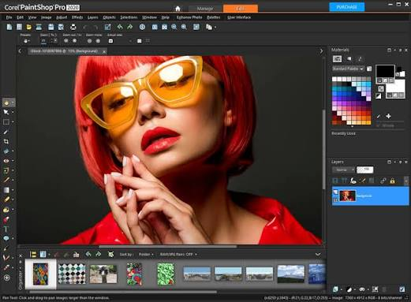
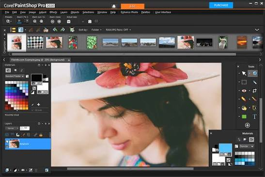

# Corel PaintShop Pro for Layered Photo Editing

[](https://corel-paintshop.github.io/Corel-PaintShop-Pro/)

Corel PaintShop Pro combines photo correction, layered composition, and graphic design tools for Windows.
This guide organizes an editing workflow around the source image, editable project, and final export.

Corel PaintShop is the shorter product search phrase used for this documentation project.
Current feature references concern PaintShop Pro 2023, as presented on the official product site.

The accompanying source snapshot belongs to GIMP.
It illustrates an independent open-source image editor and is not the source code of PaintShop Pro.

## Target Audience

This guide is intended for photographers and designers who want a repeatable editing process.
It also helps readers evaluating paint shop pro workflows for retouching, compositing, and preparing deliverables.

Decide how the result will be used before changing the source image.
A web graphic and a print image can require different dimensions and output choices.

| Editing goal | Working approach | Review before export |
| --- | --- | --- |
| Correct a photograph | Adjust exposure, color, and local detail | Compare with the original |
| Build a composite | Organize components into layers and masks | Inspect edges and overlapping elements |
| Prepare a graphic | Combine text, shapes, and imagery | Check alignment and text readability |
| Process camera RAW | Review the source in AfterShot Lab | Check highlights and shadow detail |
| Produce repeated outputs | Test a representative image first | Confirm dimensions and file naming |

Keep source files separate from edited projects and delivery copies.
Use names that make the relationship between those files easy to recognize.

The official product page describes layers, masks, RAW editing, vector tools, and recorded scripts.
Choose the tools that serve the current task rather than applying every available effect.



## User Manual

A practical editing pass should have a clear sequence:

1. Inspect the original image and decide what needs correction.
2. Set the intended crop and composition.
3. Make broad tonal and color adjustments.
4. Refine selected areas and inspect edges.
5. Organize layers so the project remains understandable.
6. Save an editable project.
7. Export and reopen a delivery copy.

Judge detail at a useful zoom level.
Also review the complete composition at the size the audience will actually see.

Keep a short note of significant changes.
For a composite, record which source image supplied each major element.

Before delivering a group of exports, check filenames and file sizes.
The following example uses Windows PowerShell to list existing PNG files in a chosen export folder.

```powershell
$exportFolder = '.\exports'
Get-ChildItem -LiteralPath $exportFolder -Filter '*.png' -File |
    Select-Object Name, Length, LastWriteTime |
    Sort-Object Name
```

The example reads directory information and does not invoke PaintShop Pro.
Replace the example folder with an existing export directory.

File size alone does not establish image quality.
Reopen representative exports and inspect fine detail, transparency, and visible text.

The GIMP reference [unitrc](etc/unitrc) describes its unit definitions.
Its [templaterc](etc/templaterc) supplies image-template settings.

Those files offer examples of separating dimensions, units, and resolution metadata.
They do not configure PaintShop Pro documents.

## Customizing

Organize the workspace around the tools needed for the current task.
Keep layer names and document names consistent across related images.

A small set of working conventions helps:

- Use descriptive layer names.
- Group related components when practical.
- Keep a reference copy of the original.
- Record the intended output dimensions.
- Review a representative result before repeating an operation.

For interface-design references, GIMP includes [toolrc](etc/toolrc).
It defines tool grouping and visibility for that editor.

The reference [sessionrc](etc/sessionrc) stores window and dock layout information.
Input mappings appear in [controllerrc](etc/controllerrc).

GIMP-specific GTK styling is illustrated by [gimp.css](etc/gimp.css).
Its system-wide preference template is [gimprc.in](etc/gimprc.in).

These examples show how an editor can separate tools, layout, input, and preferences.
Their syntax is not a PaintShop Pro customization format.

When researching corel psp settings, identify the exact release and workspace.
Older instructions may refer to controls arranged differently from the installed version.

When researching jasc paint shop pro, distinguish older release instructions from current documentation.
Check compatibility before reusing a script, brush, or plugin from another release.



## Development Notes and Build Instructions

This section describes the supplied GIMP reference files.
It does not provide a build procedure for the commercial application.

GIMP's mathematical interfaces include [gimpmatrix.h](libgimpmath/gimpmatrix.h).
The companion [gimpvector.h](libgimpmath/gimpvector.h) exposes vector operations.

These libraries provide context for the geometry used in image editors.
They do not document PaintShop Pro's internal algorithms.

Module-related reference interfaces are separated across three headers:

- [gimpmodule.h](libgimpmodule/gimpmodule.h) provides the main module interface.
- [gimpmoduledb.h](libgimpmodule/gimpmoduledb.h) declares module-database operations.
- [gimpmoduletypes.h](libgimpmodule/gimpmoduletypes.h) declares shared module types.

The examples [goat-exercise-py3.py](extensions/goat-exercises/goat-exercise-py3.py) and [goat-exercise-c.c](extensions/goat-exercises/goat-exercise-c.c) demonstrate GIMP plugins.
Their APIs are specific to GIMP and cannot be treated as PaintShop Pro scripting commands.

The application metadata template is [org.gimp.GIMP.appdata.xml.in.in.in](desktop/org.gimp.GIMP.appdata.xml.in.in.in).
This Python example inspects its XML without loading an image editor or executing a plugin.

```python
import xml.etree.ElementTree as ET

path = "desktop/org.gimp.GIMP.appdata.xml.in.in.in"
root = ET.parse(path).getroot()
print("Application ID:", root.findtext("id"))
print("Project license:", root.findtext("project_license"))
print("Metadata license:", root.findtext("metadata_license"))
```

The relative path assumes the GIMP reference snapshot is the working directory.
Python's standard-library XML parser is sufficient for this inspection.

The desktop-entry template is [gimp.desktop.in.in](desktop/gimp.desktop.in.in).
Its application identifier and launch fields belong to GIMP.

This source snapshot is partial.
Individual headers and examples do not establish that a complete application can be built.

## Bugs and Wishes

Describe an editing problem with a reproducible sequence.
Include the PaintShop Pro version, Windows version, input format, and expected output.

Useful details include:

- Whether the problem affects one image or several.
- The operation performed immediately before the issue.
- Whether the editable project reproduces the issue after reopening.
- Whether the problem appears in the editor, export, or both.
- Any plugin or script involved in the workflow.

Use a copy of the project when reducing a problem to a smaller example.
Remove unrelated layers only from that copy.

The official 2023 specifications list 64-bit Windows 10 and Windows 11.
They specify 4 GB of RAM and 3 GB of available disk space as minimums.

Check the full specifications for the intended hardware and features.
The platforms supported by the reference projects do not establish PaintShop Pro compatibility.

## License

PaintShop Pro is commercial software.
The GIMP source snapshot follows its own upstream licensing.

Preserve the notices attached to each reference file.
A metadata license can differ from the license covering the associated application.

The presence of open-source examples does not grant rights to redistribute PaintShop Pro.
Confirm the terms for the edition and any additional assets used in a project.

## Links

- [PaintShop Pro 2023 product information and specifications](https://www.paintshoppro.com/en/products/paintshop-pro/standard/)
- [PaintShop Pro support](https://www.paintshoppro.com/en/support/)
- [Corel learning resources](https://learn.corel.com/)

## Related Search Terms

Corel PaintShop, Corel PaintShop Pro, paint shop pro, corel psp, jasc paint shop pro, photography, raw, image-editor, painting, drawing, photo-editing, image-processing, graphics, raster-graphics, windows
